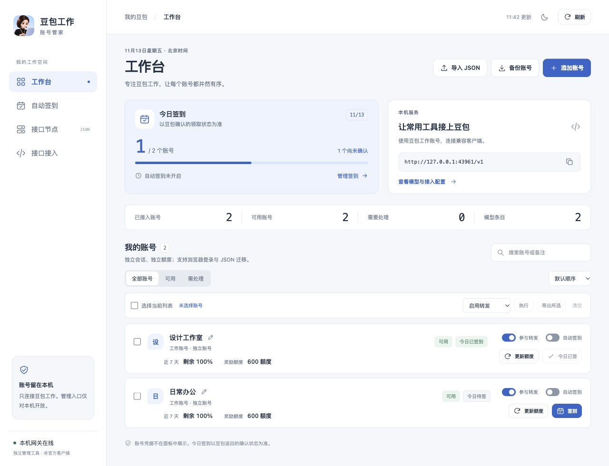
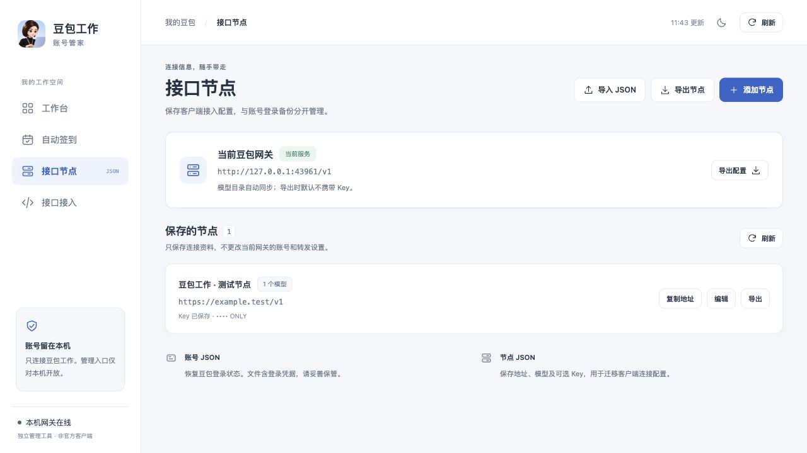
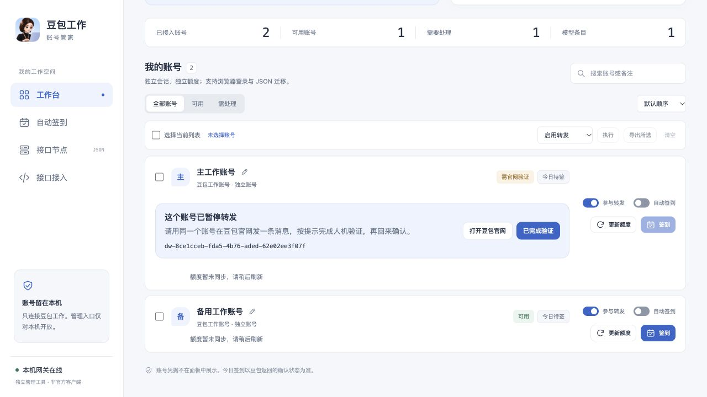

<p align="center"></p>
<h1 align="center">豆包工作 · 账号管家</h1>
<p align="center">只做豆包工作：多账号、每日签到、JSON 备份和 OpenAI 兼容接口。</p>
<p align="center"><strong>Windows / macOS / Linux</strong> · <strong>Node.js 22+</strong> · <strong>浅色 / 深色</strong></p>

> 独立第三方项目，非豆包官方产品。原生版在同一个 Node 进程中运行管理面板与模型 API，无 Agent2API、Magpie、提供商插件或 npm 运行依赖。

## 界面预览

| 工作台 | 接口节点 |
| --- | --- |
|  |  |

以上为既有布局展示，不代表当前账号的模型与额度。[签到计划](docs/screenshots/checkin.png) · [深色工作台](docs/screenshots/overview-dark-v02.jpg) · [手机工作台](docs/screenshots/overview-mobile-v02.jpg)。

## 功能

- **多账号浏览器登录**：每次在独立 Chrome / Edge 临时会话登录，同一身份更新原账号；日常浏览器不受影响。
- **账号工作台**：搜索、备注、批量启停、额度查询和验证状态。账号与模型 Key 加密保存在本机。
- **自动签到**：北京时间计划，按账号选择；同日有提交记录后只回查，不重复领取。
- **两类 JSON**：账号备份用于登录迁移；节点 JSON 用于保存客户端的 Base URL、模型及可选 Key，不参与转发选路。
- **自建 API Key**：随机生成或指定内容，支持命名、复制、启停；模型 Key 与管理接口分离。
- **文本 API**：`/v1/models` 与 `/v1/chat/completions`，支持流式和非流式文本。不承诺原生工具调用、图片及工作流兼容。

## 快速开始

安装 Node.js 22 或更高版本，取得本仓库源码，在项目目录运行：

```sh
npm start
```

1. 打开 [本机面板](http://127.0.0.1:43862)，选择「添加账号」，在独立浏览器登录。
2. 身份核验后，在「接口接入」查看模型、复制默认 Key 或创建独立客户端 Key。客户端 Base URL 默认是 `http://127.0.0.1:43861/v1`。
3. 使用 `npm stop` 或 Ctrl+C 停止；账号资料保留。用 `npm run status` 查看是否运行，`npm run doctor` 检查平台与浏览器。

也可运行 Windows 的 `start.cmd`、macOS 的 `start.command` 或 Linux 的 `start.sh`。浏览器登录需要图形桌面；服务器可从本机导出账号 JSON 后导入。见[跨平台说明](docs/platforms.md)。

## 原账号迁移

优先在工作台「导入 JSON」：支持原生备份与旧版 v2 账号 JSON。先预览、确认导入，再逐个选择「核验备份」。导入的名字或标识不代替官方身份核验。重复账号默认跳过，已核验的会话不会被未核验文件替换。

没有 JSON、但有旧版私有状态目录时，先确认旧进程已停止，再运行 `node launcher.mjs migrate-legacy`。若原目录与当前状态目录不同，将原状态目录作为命令的最后一个参数。迁移只读旧库、只写原生加密库，重复执行跳过已导入条目。旧文件保留。

原生运行目录优先使用 `DW_RUNTIME_ROOT`，其次为项目中的私有 `.runtime-root`，默认 `.local/`。可用 `DW_STATE_DIR` 单独指定状态目录。

## 遇到 429 / 710022004

这表示豆包上游要求人工验证，与普通限流和额度耗尽分开显示。网关暂停实际触发的账号，保留状态和请求编号；不会把本次请求自动转给其他账号，也不会在后台换模型重试。

1. 使用同一个账号打开[豆包官网](https://www.doubao.com/chat/)，发一条普通消息并完成页面提示的验证。
2. 回到工作台，点击「已完成验证」，再点击「复测一次」。只有收到完整的文本响应才恢复该账号参与转发。
3. 如果原出口仍要求验证，账号保持暂停。网页能发消息并不保证云端出口已经恢复。



## 数据与安全

账号会话与管理台签发的 Key 在本机用 AES-256-GCM 保存。密钥文件与加密数据均需保留。下载的账号 JSON 是可读的敏感备份；节点 JSON 默认不含 Key。请勿上传备份、状态目录、浏览器资料、Cookie 或管理员凭据。

云端模式需要 HTTPS、管理员认证和专用代理凭据；请看[部署说明](docs/cloud/README.md)。此分支的源码更新不会修改既有服务器。

## 验证与文档

- `npm run check`：源文件语法检查；`npm test`：本地模拟上游、加密库、双端口、导入导出、流式输出和暂停恢复。
- Windows / macOS / Linux 的执行结果见 [GitHub Actions](https://github.com/245678000000/doubao-work-gateway/actions)。跨平台自动测试与真实账号登录、模型和签到是不同验收项。
- [JSON 导入导出](docs/json-transfer.md) · [原生协议](docs/native-protocol.md) · [安全与反馈](SECURITY.md) · [第三方声明](THIRD_PARTY_NOTICES.md)

## 致谢

特别感谢 **[LINUX DO](https://linux.do/)** 社区的分享、讨论与交流，让这个小项目有了从想法走到可用工具的机会。

感谢 [Agent2Providers](https://github.com/ProvidersPlugin/Agent2Providers)、[EchoBird](https://github.com/edison7009/EchoBird) 和 [Chrome DevTools Protocol](https://chromedevtools.github.io/devtools-protocol/)。本项目与上述平台、社区及豆包官方无隶属、担保或官方合作关系。
