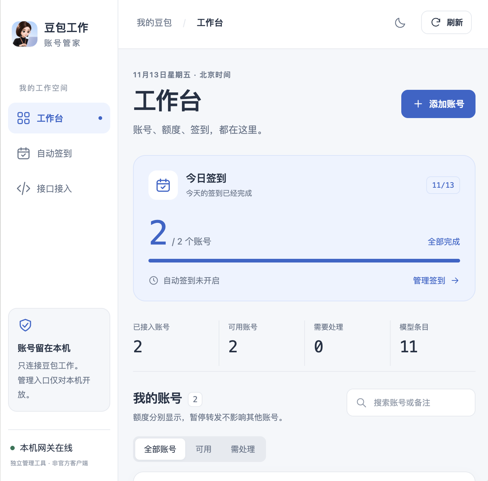
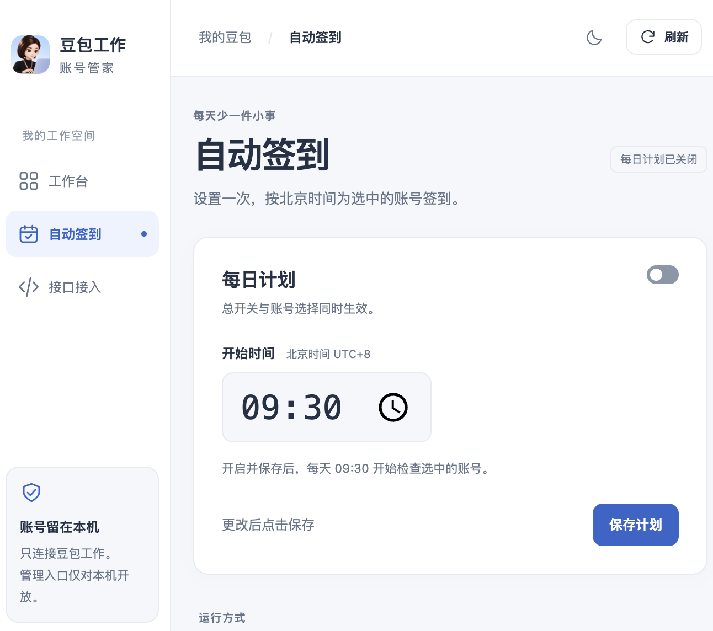

<div align="center">
  
  <h1>豆包工作 · 账号管家</h1>
  <p>只做豆包工作：多账号、每日签到、额度与 API Key，一个清爽的本机面板。</p>
  <p><strong>macOS</strong> · <strong>Node.js 22+</strong> · <strong>无 npm 第三方依赖</strong> · <strong>浅色 / 深色</strong></p>
</div>

> **独立第三方项目，非豆包官方产品。** 本仓库包含管理面板、浏览器登录桥接与签到调度代码；模型转发依赖 **Agent2API 3.4.2 + 匹配的提供商插件**。不包含上游二进制、账号数据或密钥，不是完整复刻豆包工作桌面端。

## 界面预览

<table>
  <tr>
    <td align="center"><strong>工作台</strong></td>
    <td align="center"><strong>自动签到</strong></td>
  </tr>
  <tr>
    <td valign="top"></td>
    <td valign="top"></td>
  </tr>
</table>

截图来自实际界面，仅用于展示布局；账号数、模型目录与奖励以你的账号和上游实时返回为准。

## 功能

| 功能 | 说明 |
| --- | --- |
| 多账号 | 独立浏览器登录、自动接入；同一账号再次登录更新状态，不重复新增 |
| 账号工作台 | 额度与登录状态、搜索、备注、暂停转发、手动签到 |
| 自动签到 | 北京时间每日计划、逐账号开关、同日自动提交去重、结果记录 |
| API Key 管理 | 随机生成或自定义内容、命名、复制、启用与停用 |
| 模型接入 | OpenAI 兼容接口地址、模型目录、模型 ID 与 curl 示例 |
| 外观 | 蓝白 / 深色主题、圆角头像、窄屏布局、键盘焦点与减少动画设置 |
| 异常处理 | 区分适配器离线与空账号池；部分同步失败保留并标记上次数据 |

### 项目边界

- 只在本机管理豆包工作，不提供其他提供商管理入口。
- API Key 固定限制到豆包工作模型调用，不含底层网关管理权限。
- 不是多用户后台：当前以对本机的访问权限作为管理边界，没有独立管理员/普通用户角色系统。
- 插件、云电脑、工作流和文件任务不在本版功能范围内。
- 当前完整启动链路面向 **macOS**；尚未适配 Windows / Linux 部署，也没有一键安装包。

## 开始使用

### 1. 准备环境与源码

需要：

- macOS、Node.js 22 或更高版本、Git。
- Chrome 或 Edge，用于独立浏览器登录。本机真实登录验证使用 Chrome。
- 已安装并能正常使用的豆包工作客户端；上游适配器可能读取其设备标识。
- 备用 WebKit 登录助手的首次编译才需要 Xcode Command Line Tools；浏览器登录不依赖 Swift 编译。

```sh
git clone https://github.com/245678000000/doubao-work-gateway.git
cd doubao-work-gateway
node --version
mkdir -p .local/runtime .local/state .local/tmp
```

前后端仅使用 Node.js 内置模块，**无需 `npm install`**。

### 2. 准备转发核心与提供商插件

仓库不捆绑这些依赖，请从各自项目获取：

1. 下载 [Agent2API v3.4.2 macOS Universal 包](https://github.com/aimod-cc/Agent2API/releases/tag/v3.4.2)，将其中的 `Agent2API.app` 放入本项目的 `.local/runtime/`。
2. 下载 [提供商插件 v3.4.2](https://github.com/Agent2Builder/agent2api-providers-releases/releases/tag/v3.4.2)，选择匹配架构的 macOS 包：Apple Silicon 选择 `aarch64-apple-darwin`，Intel 选择 `x86_64-apple-darwin`。
3. 首次安装插件时，从项目目录启动底层桌面网关，使用本项目独立的状态目录：

   ```sh
   AGENT2API_PROXY_HOME="$PWD/.local/state" \
   AGENT2API_PROXY_PORT=43861 \
   "$PWD/.local/runtime/Agent2API.app/Contents/MacOS/agent2api"
   ```

4. 在底层网关的「插件 → 从文件安装」中导入下载的插件，确认其中的 **豆包工作** 提供商已启用。安装过程以底层网关的提示为准。
5. **正常退出这次用于安装插件的底层网关**，释放 `43861` 端口，再启动本项目。

> 核心和插件版本需要匹配。上面的步骤是依赖准备说明，不是自动下载安装脚本。请从上游核对下载来源与版本，不要把日常其他网关的账号库直接复制进来。

### 3. 启动面板

```sh
npm start
```

也可以在 Finder 中双击项目里的 `start.command`。

| 入口 | 地址 |
| --- | --- |
| 管理面板 | [http://127.0.0.1:43862](http://127.0.0.1:43862) |
| 模型 Base URL | `http://127.0.0.1:43861/v1` |

首次启动会生成本机管理凭据和默认模型 Key；它们彼此分离。默认模型 Key 留作面板连接，不在面板中停用。端口被占用时，启动脚本会提示退出，不接管其他服务。

停止服务：

```sh
zsh ./stop.command
```

停止会保留账号与设置。也可以在启动终端按 `Ctrl+C`。本项目不安装开机自启，关闭服务后自动签到也随之停止。

<details>
<summary>已有独立运行目录，或希望将数据放在其他位置？</summary>

默认运行根目录为项目内的 `.local/`。在同一终端指定 `DW_RUNTIME_ROOT`，让启动、停止和备用助手使用另一目录：

```sh
export DW_RUNTIME_ROOT="$HOME/Library/Application Support/Doubao Work Gateway"
mkdir -p "$DW_RUNTIME_ROOT/runtime" "$DW_RUNTIME_ROOT/state" "$DW_RUNTIME_ROOT/tmp"
# 将 Agent2API.app 放在 "$DW_RUNTIME_ROOT/runtime/"，并按相同 state 路径准备插件
npm start
# 在同一终端停止
zsh ./stop.command
```

也可以在项目根目录的 `.runtime-root` 文件中放一行运行根目录的**绝对路径**，供 Finder 双击入口共用。它只作为文本路径读取，不作为脚本执行。

优先级：`DW_RUNTIME_ROOT` → `.runtime-root` → 项目内 `.local/`。`.runtime-root` 和运行目录均已加入 `.gitignore`；请勿提交其中的私有数据。

</details>

## 使用说明

### 添加账号

「工作台 → 添加账号 → 打开浏览器登录」：

1. 在新打开的豆包官方页面完成扫码或手机验证。
2. 后台核验账号并保存到本机网关。
3. 面板自动刷新，临时浏览器窗口关闭；可继续添加下一个账号。

每次使用全新的临时浏览器资料目录，不读取或复制日常 Chrome / Edge 的资料，也不退出日常浏览器账号。同一时间只运行一次登录；10 分钟未完成会结束，也可以主动取消。核验提交阶段需等待结果，避免误判是否已保存。

备用方式：先在运行中的项目上执行 `zsh ./add-account.command`，首次会编译并打开独立 WebKit 窗口；之后也可从添加账号弹窗的「其他登录方式与说明」打开。登录后点击窗口顶部「将此账号接入本机网关」，再回面板刷新。

### 每日签到

1. 在「自动签到」选择参与账号。
2. 设置北京时间，开启每日计划总开关，点击 **保存计划**。
3. 保持 Mac 唤醒、网关运行并联网。

初始默认关闭，预设时间 `09:30`。逐账号开关即时保存；总开关和时间修改需要点击保存。已签到、暂停转发或登录失效的账号会跳过。每天每账号自动提交一次；不确定结果不自动重试，留给人工核对。休眠唤醒且服务仍在运行时，会继续检查当天尚未尝试的账号。

请保持底层 Agent2API 自带定时签到关闭，避免双重调度。奖励是否可领、领取结果和额度以豆包返回为准。

### 创建自己的 API Key

「接口接入 → API Key 管理 → 创建 Key」：

- 填写名称即可随机生成 Key；推荐每个客户端一把。
- 自定义内容可选：32–128 位字母、数字、下划线或短横线。
- 在列表点击 **复制 Key**，填入你使用的客户端；后续可分别改名、停用、启用。
- 列表只显示掩码，复制时才单独取值；关闭创建窗口会清空自定义输入。
- 停用阻止后续请求，已经开始的请求可能继续；不会影响其他 Key。
- 同一创建提交标识在当前服务进程内保留 15 分钟，避免重复创建。结果不确定时先刷新核对，重启后再次手动提交也需先核对。

客户端选择 OpenAI 兼容接口，填写上方 Base URL 和你的模型 Key，模型 ID 从实时目录复制。接口页会生成使用环境变量 `DOUBAO_API_KEY` 的 curl 示例；复制不执行，实际调用可能消耗额度。

## 数据与安全

默认目录结构：

```text
.local/                         # 不提交 Git
├── runtime/
│   ├── Agent2API.app            # 上游应用，自行下载
│   └── DoubaoAccountLogin.app   # 可选，由备用登录脚本编译
├── state/                      # 账号库、密钥、设置和插件状态
└── tmp/                        # 临时浏览器资料与编译缓存
```

- 面板仅监听 `127.0.0.1`，检查 Host、Origin、跨站来源和自定义请求头。**不要直接作为公网多用户面板使用。**
- 模型调用 Key 与管理凭据分离；新建 Key 强制只允许 `doubaowork`。面板不提供管理凭据复制入口。
- 登录桥接通过匿名管道连接自己创建的浏览器实例，不开放调试监听端口，不关闭浏览器沙箱或证书验证。
- 正常成功、取消、超时与退出会清理临时会话。突发断电或强制终止可能留下 `tmp/doubao-login-*`，其中可能有登录状态。
- **不要分享 `.local/`、外置运行目录、Cookie、数据库、密钥或原始日志。** 提 Issue 前移除个人名称、账号标识、文件路径及凭据。
- 上游适配器对本机设备标识的读取由其自身实现；本项目没有宣称整个运行链路与官方客户端完全无关。

更多反馈注意事项见 [SECURITY.md](SECURITY.md)。

## 验证状态

本地验证记录日期：**2026-11-13**。这是当时的测试结果，不是对未来上游接口或所有模型的保证。

| 项目 | 状态 |
| --- | --- |
| 自动化测试 | 33 项，使用本机临时模拟数据，不操作真实账号 |
| Chrome 登录 | 真实登录、第二账号接入、列表自动刷新、临时目录清理已验证 |
| 账号与目录 | 已验证 2 个真实账号显示可用、11 个模型目录条目 |
| 文本流式调用 | 第一个账号的 DeepSeek V4.1 Flash：HTTP 200、正文 SSE 与 `[DONE]` |
| Key 管理 | 随机 / 自定义、改名、停用、启用、重启保留已在真实本机网关验证 |
| 权限隔离 | 模型 Key 访问管理接口为 403；停用后模型目录为 401 |
| 视觉与交互 | 浅色 / 深色、390px 窄屏、账号备注、搜索、模型筛选等已检查 |
| 自动签到 | 调度、北京时间与同日去重通过模拟测试；真实定时执行尚未专项验收 |
| 待验证 | Edge 实机登录、同一真实账号重登、跨账号转发路由、工具调用与图像能力 |

模型目录有某个条目，不等于该条目已完成端到端调用验收。截图中的已签到状态也不等于真实定时调度已经验收。

## 排障

| 现象 | 处理 |
| --- | --- |
| 缺少 macOS 网关 | 检查 `.local/runtime/Agent2API.app/Contents/MacOS/agent2api` 或自定义运行目录 |
| 端口被占用 | 正常退出先前的底层网关 / 本项目；本项目用 `stop.command` 停止 |
| 适配器尚未运行 | 在相同状态目录的底层网关插件页确认插件与豆包工作已启用；必要时关闭后重启该插件，再刷新 |
| 浏览器未找到 | 安装 Chrome / Edge，或按上述流程准备 WebKit 备用助手 |
| Key 或账号创建结果待核对 | 先刷新列表确认，不连续重复提交 |
| Mac 休眠后没有执行签到 | 检查唤醒、联网、服务运行、总开关和账号选择；本项目不提供独立后台守护进程 |
| 复制按钮未成功 | 保持页面在 `http://127.0.0.1:43862`，检查浏览器剪贴板权限 |

## 开发

```sh
npm run check
npm test
zsh -n start.command stop.command add-account.command runtime-env.zsh
```

```text
server.mjs          本机 HTTP 面板与底层管理 API 桥接
core.mjs            账号视图、北京时间、签到状态与原子设置写入
browser-login.mjs   独立浏览器发现、匿名管道、登录核验与清理
keys.mjs            豆包范围 Key 管理、校验、掩码与提交去重
public/             无构建步骤的前端页面、样式与脚本
Login.swift         可选的独立 WebKit 登录助手
runtime-env.zsh     各入口共用的运行目录解析
start.command       启动底层核心和本机面板
stop.command        停止本项目，保留账号数据
test/               Node.js 内置测试；路径解析测试需要 zsh
```

## 致谢

特别感谢 **[LINUX DO](https://linux.do/)** 社区的分享、讨论与交流，让这个小项目有了从想法走到可用工具的机会。

同时感谢：

- [Agent2API](https://github.com/aimod-cc/Agent2API)：本项目使用的转发核心。
- [提供商插件项目](https://github.com/Agent2Builder/agent2api-providers-releases)：提供豆包工作等适配能力，本面板只使用豆包工作通道。
- [Chrome DevTools Protocol](https://chromedevtools.github.io/devtools-protocol/)：独立浏览器登录通信所用协议；非默认资料目录设计参考 [Chrome 官方说明](https://developer.chrome.com/blog/remote-debugging-port)。

本项目与上述平台、社区及豆包官方均无隶属、担保或官方合作关系。图标和产品名称用于识别对应服务，相关权利归各自权利人。第三方依赖与素材说明见 [THIRD_PARTY_NOTICES.md](THIRD_PARTY_NOTICES.md)。
